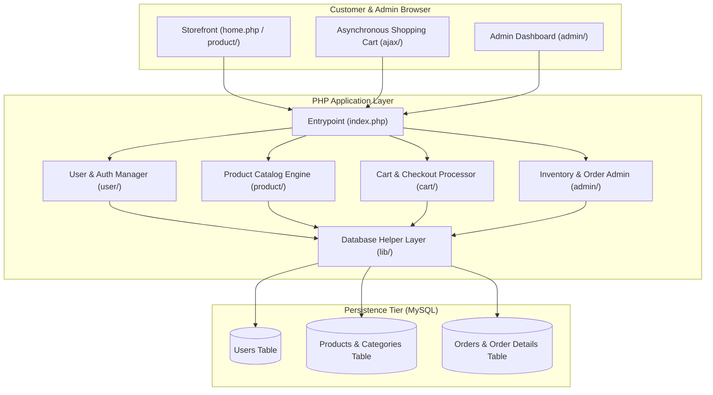

# Thuong Shop — Full-Stack E-Commerce Web Application

[](https://www.php.net/)
[](https://www.mysql.com/)
[](https://developer.mozilla.org/en-US/docs/Web/JavaScript)
[](https://getbootstrap.com/)

> A full-featured e-commerce shopping web application built with **PHP** and **MySQL**. Delivers an end-to-end shopping experience featuring asynchronous AJAX cart operations, product catalogs, customer authentication, and a complete administrative control panel.

---

## 1. System Architecture



---

## 2. Key Modules & Highlights

* **Customer Storefront & Catalog**:
  * Category navigation, product grid browsing, detailed specifications, and image galleries.
  * Real-time search and filter controls.
* **AJAX-Powered Shopping Cart**:
  * Add-to-cart, quantity updates, and item removals performed asynchronously without full-page reloads.
  * Order calculation with item totals, subtotal summaries, and shipping forms.
* **Customer Authentication & Orders**:
  * Registration, login, and session persistence.
  * Order history review and delivery tracking.
* **Administrative Control Panel (`admin/`)**:
  * Dedicated admin backoffice for product management (add, edit, delete, stock tracking).
  * Order lifecycle management (Pending -> Processing -> Completed -> Cancelled).
  * User account status and customer records overview.

---

## 3. Tech Stack

| Domain | Technologies |
| :--- | :--- |
| **Backend** | PHP 7.4+ / 8.x |
| **Database** | MySQL / MariaDB (MySQLi extension) |
| **Frontend** | HTML5, CSS3, JavaScript, jQuery / AJAX, Bootstrap |
| **Architecture** | Modular MVC / Multi-tier Web Application |

---

## 4. Getting Started

### Prerequisites
- PHP 7.4+ with `mysqli`, `pdo_mysql`, `json` extensions
- MySQL 5.7+ / MariaDB 10.4+
- Web server environment (XAMPP, WampServer, or Docker)

### Installation
1. Clone the repository into your web root (e.g. `htdocs/thuong-shop`):
   ```bash
   git clone https://github.com/btoan2802/thuong-shop.git
   ```
2. Import the database schema:
   ```bash
   mysql -u root -p < nguyenthihoaithuong.sql
   ```
3. Update database connection settings in `lib/` (or database configuration files).
4. Open your browser and navigate to `http://localhost/thuong-shop`.

---

## 5. Author & License

- **Author**: Nguyễn Bảo Toàn ([@btoan2802](https://github.com/btoan2802))
- **License**: Educational / Proprietary
